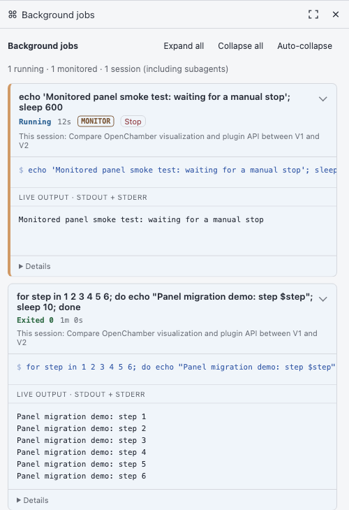

# openchamber-jobs

A jobs panel for OpenChamber 2.7.3 or newer. See commands, live output, elapsed time, and ownership across a conversation and its recursive subagents. Cancel background jobs through OpenChamber's native shell controls.

**No monitor plugin is required.** If a recorded shell call has `monitor: true`, the panel adds a MONITOR badge and exempts that job from auto-collapse. That flag means monitoring was requested, not that notifications are still flowing. [opencode-monitor](https://github.com/rndmcnlly/opencode-monitor) independently supplies incremental output notifications to the agent. The packages have synergy, but each is useful on its own: human-facing native job visibility here, agent-facing live notifications there.

<a href="./demo/openchamber-background-jobs.png"></a>

*Historical screenshot from the former companion panel. Representative of the experience; the current panel is named Jobs.*

## Install

### Release ZIP

When a release is available, download `openchamber-jobs.zip` from [GitHub Releases](https://github.com/rndmcnlly/openchamber-jobs/releases). In **Settings → Extensions → Add**, select its absolute local path or paste the HTTPS URL of the release asset. Approve shell access, the local service, and read-only OpenCode access, then open **Jobs** on the right-hand rail. The ZIP contains everything needed to run: no npm install or build on the user's machine.

The [source repository](https://github.com/rndmcnlly/openchamber-jobs) is public; no version tag or release has been published yet. GitHub Actions builds and tests the package on pushes and pull requests; pushing a version tag such as `v0.1.0` publishes the ZIP and `SHA256SUMS` to a release. The tag must match `package.json`.

OpenChamber's Git-version update detection does not apply to ZIP installs. Install a newer ZIP to upgrade, accepting replacement of the existing extension if prompted. Do not install the source repository URL: generated bundles intentionally are not committed.

### Local checkout

Requires Node 22.18+ and npm. From this directory:

```sh
npm ci
npm run check
npm run package
npm test
```

In **Settings → Extensions → Add**, select the absolute path of this repository root. A folder install uses the checkout directly. Rebuild after source changes; reload the panel for frontend changes and disable/re-enable the extension for service changes.

## Host access and upgrades

The [OpenChamber shell API](https://docs.openchamber.dev/sdk/host/#background-shells) supplies live jobs, output, and cancellation. The bundled service uses the [host's read-only OpenCode proxy](https://github.com/openchamber/openchamber/blob/v2.7.3/packages/sdk/GUEST_SERVICES.md#opencode-access) for session history only. Both follow the backend selected by OpenChamber. Jobs does not inspect processes or store OpenCode credentials.

When upgrading from the earlier checkout, reload or replace the extension and approve its updated capabilities in **Settings → Extensions**. The old `connect.mjs` flow is gone. Jobs no longer uses `~/.config/openchamber-jobs/connection.json` or the former monitor companion's connection file. It does not delete those files. Legacy cancellation metadata in message history is still recognized.

The extension's ID is `openchamber-jobs`, distinct from the former companion's `opencode-monitor`. Jobs and Background jobs can coexist during migration. The new extension has independent preferences and service approval; it does not inherit grants or collapse settings. Once Jobs is verified, uninstall the old companion before removing its checkout.

The SDK is 2.7.3 but the manifest/iframe protocol remains `apiVersion: 1`. No imports or runtime dependencies link Jobs to the monitor plugin.

## Behavior and limits

- Live jobs are scoped to the selected session and its descendants by OpenChamber. Structured assistant history supplies older cards and the monitor badge. IDs mentioned in prose are never treated as jobs.
- Foreground commands occupy a separate, hideable zone while running. They disappear after completion and cannot be cancelled here: their owning agent is waiting for the tool result.
- Cards preserve output views and text selection using keyed DOM updates. Collapse preferences are stored per conversation. Ordinary completed jobs can auto-collapse; monitored jobs stay expanded.
- Background cancellation uses OpenChamber's `stopShell`, which sends the owning agent a stop note. Jobs does not send a second notice to the viewing parent or claim it can confirm note delivery.
- Native cancellation removes retained output. Already displayed output survives until panel reload.
- Jobs saves a bounded set of observed outcomes across panel reloads. Structured completion and legacy cancellation metadata can also restore outcomes. Missing evidence stays **Record unavailable** or **Outcome unknown**.
- Only expanded cards read output. They start at the last 32 KiB and keep the most recent 256 Ki characters. OpenChamber can only retrieve output for shells it observed and OpenCode still retains. Live output combines stdout/stderr.
- No process execution is implemented here. OpenCode remains the process owner; the extension is a read model and explicit cancellation interface.

## Development and release

```sh
npm ci
npm run check
npm run package
npm test
```

`npm run package` builds and creates `dist/openchamber-jobs.zip` plus its SHA-256 checksum. Tests validate both the local manifest and the extracted package, including starting the shipped service without node_modules. TypeScript is authored source; JavaScript bundles and ZIPs are gitignored. The packaging whitelist excludes source, tests, development dependencies, and credentials.

## Lineage

Extracted from the optional OpenChamber panel in [opencode-monitor](https://github.com/rndmcnlly/opencode-monitor), itself adapted from [opencode-perk](https://github.com/rndmcnlly/opencode-perk)'s V1 cards. Bohdan Triapitsyn's [installation PR](https://github.com/rndmcnlly/opencode-monitor/pull/5) identified the root-manifest and ready-to-run-file requirements and contributed the `ps` permission and SDK manifest-testing approach. This package satisfies that contract through release ZIPs rather than checked-in bundles.

Sources: [OpenChamber SDK](https://github.com/openchamber/openchamber/tree/main/packages/sdk), [guest services](https://github.com/openchamber/openchamber/blob/main/packages/sdk/GUEST_SERVICES.md).
