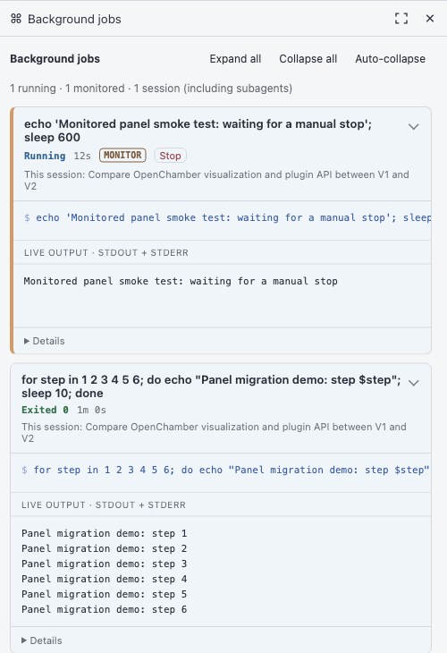

# openchamber-jobs

A jobs panel for OpenChamber 2.x backed by native OpenCode V2 shell/session APIs. See commands, live output, elapsed time, and ownership across a conversation and its recursive subagents. Cancel background jobs without leaving the agent guessing why its process stopped.

**No monitor plugin is required.** If a recorded shell call has `monitor: true`, the panel adds a MONITOR badge and exempts that job from auto-collapse. That flag means monitoring was requested, not that notifications are still flowing. [opencode-monitor](https://github.com/rndmcnlly/opencode-monitor) independently supplies incremental output notifications to the agent. The packages have synergy, but each is useful on its own: human-facing native job visibility here, agent-facing live notifications there.

<a href="./demo/openchamber-background-jobs.png"></a>

*Historical screenshot from the former companion panel. Representative of the experience; the current panel is named Jobs.*

## Install

### Release ZIP

Download `openchamber-jobs.zip` from this repository's GitHub Releases. In **Settings → Extensions → Add**, select its absolute local path or paste the HTTPS URL of the release asset. Allow the local service, then open **Jobs** on the right-hand rail. The ZIP contains everything needed to run: no npm install or build on the user's machine.

Release publishing is configured but this new repository has not yet been published. GitHub Actions builds and tests the package on pushes and pull requests; pushing a version tag such as `v0.1.0` publishes the ZIP and `SHA256SUMS` to a release. The tag must match `package.json`.

OpenChamber's Git-version update detection does not apply to ZIP installs. Install a newer ZIP to upgrade, accepting replacement of the existing extension if prompted. Do not install the source repository URL: generated bundles intentionally are not committed.

### Local checkout

Requires Node 22.18+ and npm. From this directory:

```sh
npm ci
npm run check
npm run package
npm test
```

In **Settings → Extensions → Add**, select the absolute path of this repository root. A folder install uses the checkout directly. Rebuild after source changes; reload the panel for frontend changes and disable/re-enable the extension for service changes.

## Backend connection and compatibility

The macOS desktop service automatically discovers OpenChamber's managed OpenCode backend, preferring the instance owned by its host process. It verifies the PID through `/api/info` before connecting. The declared `ps` permission discloses process-environment access used to recover the managed backend password; it is advisory, not a sandbox.

On other platforms, or if discovery cannot select exactly one backend, have an agent inside the intended OpenChamber instance run:

```sh
node connect.mjs
```

Run this from the checkout or an extracted release directory. It writes private connection credentials to `~/.config/openchamber-jobs/connection.json`, outside the package and browser frame. On non-macOS systems rerun it after backend restarts. The service also reads the old companion's `~/.config/opencode-monitor/connection.json` when the new file is absent, and accepts legacy cancellation metadata.

The extension's ID is `openchamber-jobs`, distinct from the former companion's `opencode-monitor`. Jobs and Background jobs can coexist during migration. The new extension has independent preferences and service approval; it does not inherit grants or collapse settings. Once Jobs is verified, uninstall the old companion before removing its checkout.

The SDK is 2.x but the manifest/iframe protocol remains apiVersion 1. The extracted Jobs panel has been exercised live against OpenChamber 2.x and OpenCode 2.0.21, including an ordinary job with no monitor input and its live output. The predecessor was tested against OpenCode 2.0.16. This extension requires the V2 shell/session APIs used here, not merely any server with a similar UI. No imports or runtime dependencies link it to the monitor plugin.

## Behavior and limits

- Background jobs are recovered from structured assistant tool history, including older pages, then checked against native shell ownership/state. IDs mentioned in prose are never treated as jobs.
- Foreground commands occupy a separate, hideable zone while running. They disappear after completion and cannot be cancelled here: their owning agent is waiting for the tool result.
- Cards preserve output views and text selection using keyed DOM updates. Collapse preferences are stored per conversation. Ordinary completed jobs can auto-collapse; monitored jobs stay expanded.
- Background cancellation uses native shell removal. Both the owner and the viewing parent receive an intentional-cancellation notice with instructions not to automatically restart a human-cancelled job. Cancellation provenance survives service reloads.
- Native cancellation removes retained output and may generate Shell.NotFoundError in the agent conversation. Already displayed output survives until panel reload. Notification failures are reported separately from a successful stop.
- Native records can expire. Structured completion/cancellation metadata restores outcomes where available; missing evidence stays **Record unavailable**, not an invented success or elapsed duration.
- Only expanded cards read output: 32 KiB per request, keeping the most recent 256 Ki characters. Large session trees can make the first history scan slower. Live output combines stdout/stderr.
- No process execution is implemented here. OpenCode remains the process owner; the extension is a read model and explicit cancellation interface.

## Development and release

```sh
npm ci
npm run check
npm run package
npm test
```

`npm run package` builds and creates `dist/openchamber-jobs.zip` plus its SHA-256 checksum. Tests validate both the local manifest and the extracted package, including starting the shipped service without node_modules. TypeScript is authored source; JavaScript bundles and ZIPs are gitignored. The packaging whitelist excludes source, tests, development dependencies, and credentials.

## Lineage

Extracted from the optional OpenChamber panel in [opencode-monitor](https://github.com/rndmcnlly/opencode-monitor), itself adapted from [opencode-perk](https://github.com/rndmcnlly/opencode-perk)'s V1 cards. Bohdan Triapitsyn's [installation PR](https://github.com/rndmcnlly/opencode-monitor/pull/5) identified the root-manifest and ready-to-run-file requirements and contributed the `ps` permission and SDK manifest-testing approach. This package satisfies that contract through release ZIPs rather than checked-in bundles.

Sources: [OpenChamber SDK](https://github.com/openchamber/openchamber/tree/main/packages/sdk), [guest services](https://github.com/openchamber/openchamber/blob/main/packages/sdk/GUEST_SERVICES.md).
